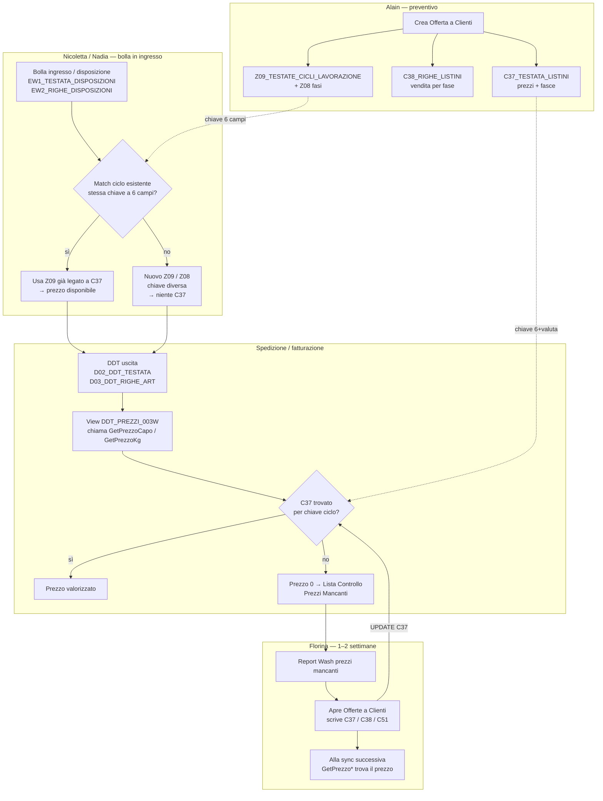
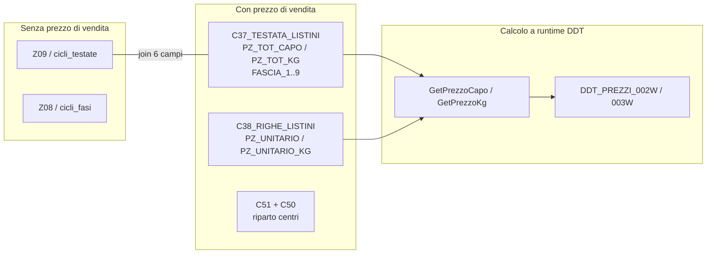
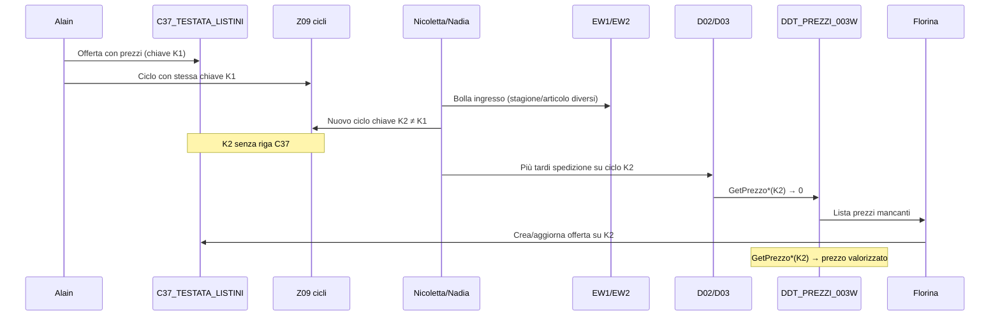

# Flusso offerte, cicli e prezzi mancanti

Documento di sintesi dei fatti verificati (chat nov 2026 + controlli su Oracle `INT2DB` / Postgres locale `intexdata`).  
Solo dati oggettivi: mappature, query, confronti export, foto UI vs DB.

---

## 1. Problema in una frase

Un **ciclo di produzione** (`Z09`) senza **offerta/listino** allineata (`C37`) non ha prezzo di vendita; le spedizioni (DDT) su quel ciclo compaiono nel report Wash **Lista Controllo Prezzi Mancanti**.

---

## 2. Attori e responsabilità (fabbrica)

| Attore | Ruolo osservato |
| :--- | :--- |
| **Alain** | Crea il **preventivo/offerta**. Wash genera anche il **ciclo** corrispondente (fasi + prezzi sull’offerta). |
| **Nicoletta / Nadia** | Gestiscono la **bolla in ingresso**. Cercano un ciclo già esistente; se stagione/articolo/fasi non coincidono creano un **nuovo ciclo** (spesso **senza** offerta → senza prezzo). |
| **Florina** | Consulta il report prezzi mancanti **ogni 1–2 settimane** (chiusura fatturazione mese). Popola i prezzi nella schermata **Offerte a Clienti**. |

---

## 3. Modello dati — oggetti e chiavi

### 3.1 Offerta (preventivo commerciale)

| Ruolo | Oracle | Postgres sync |
| :--- | :--- | :--- |
| Testata offerta | `INTEX2.C37_TESTATA_LISTINI` | `c37_testata_listini` |
| View testata arricchita | `INTEX2.C37_001W` | — |
| Righe fasi / vendita capo-kg | `INTEX2.C38_RIGHE_LISTINI` | (non syncata in questo flusso) |
| Centri di costo (riquadro TINTORIA) | `C51_RIPARTIZIONI_COSTI_CDC` + `C50_CDC_TAB` | — |

**Chiave offerta (7 campi):**

```text
cliente + linea + stagione + composizione + articolo + ciclo + valuta
```

| Campo UI | Colonna |
| :--- | :--- |
| Cod. Univoco | `C37_PRG` |
| Prezzo Capo / Prezzo Kg | `C37_PZ_TOT_CAPO` / `C37_PZ_TOT_KG` |
| Fasce a Kg 1–4 / a Capo 5–8 | `C37_QT/PZ/TP/TQ_FASCIA_1..8` (+ fascia 9) |
| Stato UI | `C37_FLAG_VISIBILE`: `P` = Prototipo / da accettare, `S` = Offerta accettata |
| Note libere | `C37_NOTE_LIBERE` |

**Fasce vs prezzo generico:** `GetPrezzoCapo` / `GetPrezzoKg` usano le fasce in base alla quantità; se non applicabili restano i totali `C37_PZ_TOT_*`.

`C38_C37_PRG` è **sempre NULL**: le fasi offerta si legano a C37 solo via chiave a 7 campi, non via Cod. Univoco.

### 3.2 Ciclo di lavorazione

| Ruolo | Oracle | Postgres sync |
| :--- | :--- | :--- |
| Testata ciclo | `INTEX2.Z09_TESTATE_CICLI_LAVORAZIONE` | `cicli_testate` |
| Fasi del ciclo | `INTEX2.Z08_CICLI_LAVORAZIONE` | `cicli_fasi` |
| Descrizione fase | `INTEX2.Z02_FASI_DI_LAVORO` | `fasi_lavoro` |

**Chiave ciclo (6 campi):**

```text
cliente + articolo + ciclo + linea + stagione + composizione
```

`cicli_testate` **non ha colonne prezzo** (verificato su `information_schema` in Postgres locale).

### 3.3 Legame offerta ↔ ciclo

Non esiste un ID di foreign key dedicato. Join naturale:

```text
C37.{cliente, articolo, ciclo, linea, stagione, composizione}
  = Z09.{cliente, articolo, ciclo, linea, stagione, composizione}
```

(L’offerta ha in più `valuta`, tipicamente `01` EURO.)

Verifica locale (offerte `c37_prg >= 41000`, stagioni non `pe/ai`/`*`): **860/870** con ciclo matchato sulla chiave a 6 campi.

---

## 4. Diagramma — da preventivo a prezzo in fattura



---

## 5. Diagramma — dove vivono i prezzi



---

## 6. Report prezzi mancanti (Wash)

### 6.1 Catena view Oracle

| View | Ruolo |
| :--- | :--- |
| `DDT_PREZZI_000W` | Base: DDT non fatturati (`D02_FLAG_FATTURATA = 'N'`) con disposizione |
| `DDT_PREZZI_001W` | + cliente, linea, stagioni, composizione, ciclo, `Z09_FL_PREZZO_ZERO` |
| `DDT_PREZZI_002W` | Calcolo prezzi (`GetPrezzoCapo` / `GetPrezzoKg` / forfait; anche rami `C45`/`C46`) |
| `DDT_PREZZI_003W` | Come 002W + `EW2_CD_STAGIONE_PROD` / `DS_STAGIONE_PROD` |
| `DDT_PREZZI_005W` | Variante più snella |
| `PRINT_DDT_DA_FATTURARE` | Riepilogo su `002W` |

**Candidata del report PDF** (colonne stagione listino **e** stagione produzione): `DDT_PREZZI_003W`.

Dipendenze verificate (`user_dependencies`): `DDT_PREZZI_002W`, `DDT_PREZZI_003W`, `PRINT_DDT_DA_FATTURARE` referenziano `C45LISTINOCAPO` e `C46LISTINOCAPO`. Nel corpo di 002W/003W il percorso principale sulle disposizioni usa **`GetPrezzoCapo` / `GetPrezzoKg`** su `C37`.

Le view sono **non materializzate**: ogni `SELECT` ricalcola; un `COUNT(*)` su `DDT_PREZZI_003W` (~4042 righe) è lento perché esegue join + function per riga.

### 6.2 Estratto logica prezzo (002W/003W)

```sql
DECODE(
  EW2_FLAG_TIPO_PREZZO,
  'C', EW2_PRZ_UNITARIO,
  'F', 0,
  getprezzocapo(cliente, linea, stagione, comp, gr_comp, articolo, ciclo, tp_prod, qta)
)
```

Se non c’è listino C37 applicabile → tipicamente **0** → riga “prezzo mancante”.

### 6.3 PDF OCR vs Oracle (stesso intervallo date DDT)

Fonte OCR: `documentation/Intex -listino controllo prezzi mancanti.txt`  
- Intestazione: **Data report 23/10/2026**, **142** righe prodotto.  
- Date `data_ddt` osservate: **02/10/2026 → 23/10/2026** (non dimostrano da soli un filtro “mese intero”; compatibile con da/a fino alla data report).

Export Oracle (query su `DDT_PREZZI_003W`, prezzi capo/kg/forfait = 0, `d02_dt_bolla` tra 01 e 23/10/2026):  
`documentation/prezzi_mancanti_2026-10-01_23.txt` → **143** righe.

Confronto automatico (chiavi cli/disp/ciclo/qty, con tolleranza OCR su n. disposizione):

| Esito | ≈ N |
| :--- | ---: |
| Match (ancora senza prezzo) | 80 |
| Solo OCR (nel PDF, assenti dall’export) | 62 |
| Solo Oracle | 63 (di cui **47** con `NS_DDT = 0/0`) |

I `NS_DDT = 0/0` gonfiano Oracle rispetto al report gestionale.

---

## 7. Verifica foto UI “Offerte a Clienti” vs Postgres locale

Container: `intexdata`. Conteggi al momento del check: `c37_testata_listini` ≈ 34119, `cicli_testate` ≈ 108484.

| Caso foto | Offerta C37 | Prezzo foto | Prezzo DB | Ciclo Z09 |
| :--- | :--- | :--- | :--- | :--- |
| IN.CO **1213** T100L-TELI AI27 art. 00058 — PRG **41645** | Trovata, `FLAG=S` | Capo 0 / Kg **9,50** | **0 / 9,5** | Presente — senza colonne prezzo |
| Peserico **112** ciclo cli T13 / T137 art. 00049 PE27 — PRG **41314** | Trovata, `FLAG=S` | Capo **7** / Kg **5,65** + fasce | **7 / 5,65** + fasce allineate | Presente — senza prezzo |
| Area Fashion **697** T202 AI27 lin. 01 — PRG **41591** | Trovata, `FLAG=P` | Capo 0 / Kg **0,68** | **0 / 0** | Presente — senza prezzo |
| Lucy’s **1421** T400 AI27 — in DB PRG **41613** (non 49453) | Trovata, `FLAG=P` | Capo **3,90** | **5,5 / 0** | Presente — senza prezzo |
| Incontro **2010** ciclo **7103** | **Assente** in dump locale | Kg **3,44** | — | **Assente** |

**Conclusione oggettiva:** i prezzi della scheda offerta sono in **`C37`**; **`Z09` non memorizza il prezzo di vendita**. Differenze foto↔DB (Area Fashion, Lucy’s, Incontro) indicano sync incompleto/ritardato o record non presenti nel dump, non un prezzo sul ciclo.

---

## 8. Pipeline sync già presente (Postgres)

Script: `scripts/extract_upload_tables_storico_365.py` + `scripts/import_storico_disposizioni.sh`.

| CSV / tabella | Contenuto rilevante al flusso |
| :--- | :--- |
| `c37_testata_listini` | Offerte + prezzi + fasce |
| `cicli_testate` / `cicli_fasi` (+ anagrafiche) | Cicli Z09/Z08 |
| `ew1_*` / `ew2_*` | Disposizioni (bolla ingresso / storico) |
| `ddt_testate` / `ddt_righe` | DDT uscita D02/D03 (semplificati) |
| `ddt_prezzi_003w` | Snapshot **completo** della view Oracle `DDT_PREZZI_003W` (`SELECT *`, ~4k DDT non fatturati) |

DDL: `data/migrations/create-ddt-prezzi-003w.sql`. L’API `/api/admin/prezzi-mancanti` filtra capo/kg/forfait = 0 + range da/a su `d02_dt_bolla`.

**Certezza sulla view:** `003W` è la candidata migliore (uniche colonne stagione listino **e** produzione come il PDF Wash; confronto OCR ≈80 match), non prova formale al 100% che il report Wash punti proprio a quella (potrebbe essere `002W` + join stagione, o filtro UI diverso). Non è una tabella Oracle: è una view.

---

## 9. Function Oracle rilevanti (prezzo)

| Function | Ruolo |
| :--- | :--- |
| `GetPrezzoCapo` / `GetPrezzoKg` | Risoluzione prezzo da `C37_TESTATA_LISTINI` (+ fasce) |
| `GetPrezzoForfait` / `GetPrezzoForfaitSpecifico` / `GetFlagPrezzoForfait` | Forfait |
| `C45ListinoCapo/Kg`, `C46ListinoCapo/Kg` | Listino fase C45/C46 (rami view / fasi extra) |
| `GetPrzListinoCapo/Kg` | Wrapper C46 poi C45 |
| `Listino_Gruppo_Comp` | Comp vs gruppo composizione su C37 |
| `ListinoUsato` | Uso chiave listino su `EW2_RIGHE_DISPOSIZIONI` |

Sorgenti esportati in chat: `documentation/used-single-stored-proc.tx`.  
DDL view: `documentation/ddt_prezzi_views.sql`.

---

## 10. Diagramma — disallineamento tipico (causa root)



---

## 11. Riferimenti file

| File | Contenuto |
| :--- | :--- |
| `documentation/analisi-offerte.md` | Mappatura UI Offerte ↔ C37/C38/Z09 |
| `documentation/ddt_prezzi_views.sql` | DDL `DDT_PREZZI_*` + `PRINT_DDT_DA_FATTURARE` |
| `documentation/Intex -listino controllo prezzi mancanti.txt` | OCR report 23/10/2026 (142 righe) |
| `documentation/prezzi_mancanti_2026-10-01_23.txt` | Export Oracle mancanti 01–23/10 |
| `documentation/used-single-stored-proc.tx` | Sorgenti GetPrezzo*/C45/C46/Listino* |
| `documentation/used-stored-prc2.txt` | Dipendenze view → C45/C46 |
| `scripts/extract_upload_tables_storico_365.py` | Export Oracle → SFTP |
| `scripts/import_storico_disposizioni.sh` | Import CSV → Postgres |

---

## 12. Limiti noti (fatti)

- Il parametro esatto da/a del report Wash **non** è nel DDL della view: il filtro data è lato UI/report.
- Enrichment richiesto in fabbrica (bolla ingresso, colore, suggerimenti cicli compatibili con score) **non** è nella view `DDT_PREZZI_003W` attuale; il bottone UI “Cicli compatibili” esiste in Wash ma la logica non è stata esportata in questa chat.
- Postgres locale può essere **indietro** rispetto a Oracle/UI (es. offerte foto non allineate o assenti).

---

## 13. Glossario operativo — disposizione, bolla, cartellino

Tre oggetti distinti nel gestionale / Oracle. In fabbrica “bolla” può indicare l’ingresso (disposizione) o l’uscita (DDT): a database sono tabelle diverse.

```text
Cliente spedisce merce
  → Disposizione (EW1 / EW2)          ingresso + ordine di lavoro
      → Cartellino (P06 / P07 / P10)  unità di produzione fisica
          → Bolla / DDT (D02 / D03)   uscita / spedizione verso cliente
```

### 13.1 Disposizione

**Definizione:** documento di **carico in ingresso**: registra la merce arrivata dal cliente e apre il lavoro (articolo, ciclo, stagione, composizione, quantità). È ciò che Nicoletta/Nadia gestiscono come “bolla in ingresso”. **Non** è il cartellino né il DDT di uscita.

| Ruolo | Oracle | Postgres sync |
| :--- | :--- | :--- |
| Testata | `INTEX2.EW1_TESTATA_DISPOSIZIONI` | `ew1_testata_disposizioni` |
| Righe | `INTEX2.EW2_RIGHE_DISPOSIZIONI` | `ew2_righe_disposizioni` |
| Vista griglia | (export denormalizzato) | `storico_disposizioni` |

**Chiave:** `anno_disposizione + nr_disposizione` (testata); sulle righe anche `riga_disposizione`.

**Contiene (EW1 — testata):** cliente, data/nr bolla **del cliente** (`EW1_DATA_BOLLA_CLI`, `EW1_NR_BOLLA_CLI`), linea, stagione, flag chiuso, provenienza, riferimenti cliente.

**Contiene (EW2 — riga):** articolo (fiscale/fattura), composizione, ciclo, colore, capi/kg **caricati**, note, vasca/reparto, date consegna, totali già spediti (`EW2_NR_CAPI_DDT`, `EW2_KG_DDT`), stagione listino e stagione produzione (`EW2_CD_STAGIONE`, `EW2_CD_STAGIONE_PROD`), eventuali prezzi unitari sulla riga.

Nel report prezzi mancanti: colonna **Ns.disposiz** (`D03_ANNO_DISP_CLI` / `D03_NR_DISP_CLI`).

### 13.2 Bolla (DDT di uscita)

**Definizione:** documento di **spedizione in uscita** (DDT) verso il cliente, dopo la lavorazione. Base per fatturazione (`D02_FLAG_FATTURATA`). Nel report Wash è **Ns.DDT** / data DDT — non confonderlo con la “bolla in ingresso” (= disposizione).

| Ruolo | Oracle | Postgres sync |
| :--- | :--- | :--- |
| Testata | `INTEX2.D02_DDT_TESTATA` | `ddt_testate` (semplificata) |
| Righe articolo | `INTEX2.D03_DDT_RIGHE_ART` | `ddt_righe` (semplificata) |
| Tipologia documento | `INTEX2.I01_TIPOLOGIA_BOLLE` | — |

**Chiave:** `D02_KEY` / `anno_bolla + nr_bolla`; riga `D03_RIGA` collegata via `D03_KEY_D02`.

**Contiene (D02 — testata):** tipo bolla, data bolla, cliente fattura, valuta, flag fatturata, agenti, pagamento/ABI/CAB.

**Contiene (D03 — riga):** articolo, capi/kg **in uscita**, IVA/sconti/provvigioni, note; riferimenti alla **disposizione** (`D03_ANNO/NR/RIGA_DISP_CLI`) e al **cartellino** (`D03_ANNO_CARTELLINO`, `D03_NR_CARTELLINO`).

Relazione tipica: una disposizione → più DDT (spedizioni parziali); un DDT → righe da una o più disposizioni. Le view `DDT_PREZZI_*` partono da D02/D03 non fatturati con disposizione valorizzata e calcolano i prezzi via ciclo → `C37`.

### 13.3 Cartellino

**Definizione:** unità di **produzione fisica** (lotto/tag) generata sotto una riga disposizione. Non sostituisce la disposizione: `P06` **punta** a `EW2` e la riga DDT può citare entrambi.

| Ruolo | Oracle | Note |
| :--- | :--- | :--- |
| Testata cartellino | `INTEX2.P06_CARTELLINI_PROD` | legame a disposizione (`P06_ANNO/NR/RIGA_DISPOSIZIONE`) |
| Cicli / bagni sul cartellino | `INTEX2.P07_CICLI_CARTELLINI` | es. `P07_NR_BAGNO`, kg/capi programmati |
| Fasi extra | `INTEX2.P10_FASI_EXTRA` | fasi aggiuntive legate al cartellino |

**Chiave:** `anno_cartellino + nr_cartellino`.

**Contiene (da join nelle view prezzi):** riferimento disposizione di origine; flag uso kg in ricerca prezzi (`P06_FLAG_USAKGINRICERCAPREZZI`); su `P07` bagno e quantità programmate usate nei rami “con bagno” / “senza bagno” di `DDT_PREZZI_002W` / `003W`.

Join tipico (fasi extra / prezzi):

```text
D03.(anno|nr)_cartellino
  = P06.(anno|nr)_cartellino
  = P07 / P10.(anno|nr)_cartellino

P06.(anno|nr|riga)_disposizione
  = EW2.(anno|nr|riga)_disposizione
```
