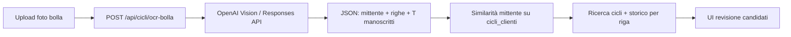

# Analisi: Upload bolla + OCR → matching cliente e cicli

Documento di analisi (nessuna modifica al codice). Obiettivo: definire i passi necessari per aggiungere alla pagina **Cicli** una seconda modalità «Upload bolla», in cui l’utente carica la foto di una bolla cliente, il sistema estrae il testo via OpenAI Vision/OCR, identifica il cliente per similarità e propone per ogni riga uno o più cicli di lavorazione candidati (da tabelle cicli + storico disposizioni).

Documenti / codice di riferimento:

| Asset | Ruolo |
| :--- | :--- |
| `frontend/app/src/pages/CicliPage.jsx` | UI ricerca cicli attuale (`panel__head`: «Ricerca cicli di lavorazione») |
| `backend/cicli_routes.py` | API `GET /api/cicli*`, filtri, join storico, `cicli_search` |
| `backend/LLMservice.py` | Chiamate OpenAI Responses API con `OPENAI_APIKEY` / `LLM_PROVIDER` |
| `data/migrations/create-cicli-tables.sql` | `cicli_clienti`, `cicli_testate`, `cicli_fasi`, `articoli_cliente`, … |
| `data/migrations/create-storico-disposizioni-tables.sql` | `ew1_testata_disposizioni`, `ew2_righe_disposizioni` |
| `data/migrations/cicli-storico-search.sql` | `cicli_search.search_doc` + trigrammi / `word_similarity` |
| [`new-filters-logic-storico-and-cicli.md`](./new-filters-logic-storico-and-cicli.md) | Chiave a 6 campi ciclo ↔ storico; filtri già implementati |
| [`refresh-cicli-search.md`](./refresh-cicli-search.md) | Quando e come refreshare `cicli_search` |
| [`esempi-bolle/`](./esempi-bolle/) | 4 foto reali di DDT in ingresso (WhatsApp, ott 2026) — golden set di layout |
| `frontend/app/src/components/DdtAssistPanel.jsx` + `/api/ddt/assist*` | Precedente UX di riconciliazione riga-per-riga (cliente noto, input manuale) — pattern UI/API utile da riusare |

---

## 1. Sintesi esecutiva

Oggi la pagina Cicli espone solo la **ricerca a filtri**. Si propone di aggiungere, vicino al titolo, uno **switch a due opzioni**:

1. **Ricerca attuale** — comportamento invariato (`CicliPage` + `GET /api/cicli`).
2. **Upload bolla** — UI nuova: upload immagine → OCR strutturato → matching cliente → matching cicli per riga → revisione utente.

Pipeline proposta (alta livello):



**Principio di design:** l’OCR propone; l’utente conferma. Nessun inserimento automatico in Oracle/Postgres: l’output è una lista di **candidati** (cliente + cicli) con score di confidenza, da cui l’utente può passare alla ricerca cicli già esistente o aprire il dettaglio fasi/utilizzi.

**Insight dai campioni** ([`esempi-bolle/`](./esempi-bolle/)): il cliente Intex è il **mittente** del DDT (non INTEX); i codici manoscritti tipo `T200`/`T205` sono spesso il `codice_ciclo`; le descrizioni con `+` sono fasi di lavorazione già allineate a `cicli_search`. Dettaglio in §2.1.

---

## 2. Contesto dominio: cosa contiene una bolla

Le bolle in ingresso ad Intex sono **Documenti di Trasporto (DDT)** emessi dal cliente di lavorazione (mittente) e indirizzati a **INTEX SRL** (destinatario). Campioni reali in [`documentation/esempi-bolle/`](./esempi-bolle/) (§2.1).

### 2.0 Regola critica: chi è il «cliente»

| Ruolo sul DDT | Esempio tipico | Uso Intex |
| :--- | :--- | :--- |
| **Mittente** (logo / intestazione emittente) | `meeting group SpA`, `TRANSIT M & COMPANY`, `Project S.r.l.`, `cage Maglierie` | È il **cliente** da matchare su `cicli_clienti.ragione_sociale` |
| **Destinatario / Spett.le / Fornitore (verso Intex)** | sempre `INTEX SRL`, Via Monte Corno 5, Sarcedo | **Non** è il cliente da cercare; va escluso dal matching |
| Campo stampato «Codice cliente» sul DDT | es. `0001588`, `00` | È il codice **del mittente verso Intex**, non il `codice_cliente` Intex → **non** usarlo come chiave diretta |

Senza questa regola l’OCR proporrebbe sempre «INTEX» come cliente e il matching cicli fallirebbe.

### 2.0.1 Zone del documento

| Zona documento | Contenuto tipico (dai campioni) | Uso nel matching |
| :--- | :--- | :--- |
| Intestazione mittente | Ragione sociale, logo, indirizzo, P.IVA mittente | Identificazione `codice_cliente` Intex |
| Box destinatario | INTEX SRL + indirizzo Sarcedo | Rumore da ignorare per il cliente |
| Meta documento | N. DDT, data, causale (`C/LAVORAZIONE`, `Conto Lavoro`, `MERCE CONTO LAVORAZIONE`) | Filtro soft (conferma che è bolla di lavorazione); data bolla |
| Corpo (righe) | Codice articolo cliente, descrizione capo, varianti/colori, qty (NR/Pz/KG), commessa/ODP | Match articolo/modello/colore/commessa |
| Descrizione lavorazione | Catene tipo `TINTO CAPO`, `RIENTRO+TINTURA+ENZIMA`, elenchi fasi con `+` | Match forte su `cicli_search` / `ds_ciclo` |
| **Annotazioni a mano** | Codici tipo `T200`, `T182 T242`, `T183B`, `T205`; qty kg; note «SALDO» | Spesso **`codice_ciclo` Intex** o note operative — segnale ad altissima priorità |
| Piè | Aspetto beni (ceste, sacchi, pallet), colli, firme | Rumore logistico |

La chiave a 6 campi Intex **non** è stampata sul DDT. Va inferita da mittente + campi riga + (quando presenti) annotazioni `T…` e testo fasi, confrontando:

- anagrafiche cicli (`cicli_testate`, `articoli_cliente`, `composizioni`, `cicli_search`);
- storico disposizioni (`ew1` / `ew2`: modello, colore, tessuto/qualità, rif. disp. cliente, note).

---

## 2.1 Analisi bolle di esempio (`documentation/esempi-bolle/`)

Quattro JPEG da smartphone (≈1152×2048, progressive), foto di DDT fisici in raccoglitore. Sono il **golden set iniziale** per prompt OCR, soglie matching e test di accettazione.

### 2.1.1 Inventario

| File | Mittente (cliente atteso) | N. / data DDT | Pattern riga dominante | Annotazioni a mano rilevanti |
| :--- | :--- | :--- | :--- | :--- |
| `WhatsApp Image … 08.22.00.jpeg` | **meeting group SpA** (Lancenigo) | DOC. DI TRASPORTO 12/10/20 (anno stampato ambiguo; contesto 2026) | 1 blocco: art. `D6262400009`, `BLUSA MISTO SETA`, var. `10009`, 492 NR, CO 72% / SE 28%, `DISPOSIZIONE PROT 2026 90280 TINTO CAPO`, commessa `PROT/2026/90280` | `T200`, `CO/SE` |
| `… 08.22.00 (1).jpeg` | **TRANSIT M & COMPANY s.p.a.** (Carrè) | 1409/L del 13.10.2026 | 6 righe: codice tipo `SS26 U S/C122 COL U0x`, stessa desc. `RIENTRO+TINTURA COTONE+ENZIMA`, qty in KG | `T182 T242`, cerchiato `8702`, «EMAIL 13/10» |
| `… 08.22.00 (2).jpeg` | **Project S.r.l.** (Malo) | 3935/DDT del 13/10/26 | 1 riga: codice `8BMX019 PF RO190H6 501`, `PANNELLO 95X70` + catena fasi `SBIANCA/PURGA + TINTURA DIRETTA + ENZIMI…`, comm. `45855`, 296 Pz | `T183B`, `Q316`, `Kg. 33,50`, `SALDO`, cerchiato `8701` |
| `… 08.22.00 (3).jpeg` | **cage Maglierie S.r.l.** (Veronella) | Numero 619 del 13/10/26 | 3 varianti stesso art. `22CMSS080A002246G` (totali colori TOTAL ECLIPSE / DOVE / BLACK), griglia taglie, note `T205 TINTO CAPO REATTIVO + RASAPELO + NO MORBIDO` | Cerchiato `8686`, qty kg a mano, note «COPRI ZIP» |

Destinatario su **tutti e quattro**: INTEX SRL, Via Monte Corno 5, 36030 Sarcedo (VI).

### 2.1.2 Pattern ricorrenti (implicazioni prodotto)

1. **Layout non uniforme** — ogni mittente ha un template DDT diverso (Meeting / Transit / Project / Cage). L’OCR non può basarsi su coordinate fisse: serve estrazione semantica (Vision + schema JSON), non template matching.
2. **Cliente = mittente** — conferma empirica della regola §2.0. Prompt e post-process devono bloccare `INTEX` / `INTEX SRL` come candidato cliente.
3. **Codice ciclo spesso manoscritto** — pattern `T` + cifre (`T200`, `T182`, `T242`, `T183B`, `T205`). Va estratto in un campo dedicato `codice_ciclo_manoscritto` (lista) e usato come **match esatto prioritario** su `cicli_testate.codice_ciclo` / `codice_ciclo_cli` per quel cliente.
4. **Fasi in testo stampato con `+` / `/`** — es. `RIENTRO+TINTURA COTONE+ENZIMA`, `SBIANCA/PURGA + TINTURA DIRETTA + …`. Allineato a `norm_search` / `cicli_search` (già normalizza `+`, `/`, …). Campo `fasi_testo` ad alta priorità nel ranking.
5. **Una «riga OCR» ≠ una riga tabellare semplice**
   - Meeting/Project: blocco multi-riga (articolo + disposizione + composizione).
   - Transit: N codici colore × stessa lavorazione.
   - Cage: N varianti/colori × stesso articolo + griglia taglie + blocco istruzioni sotto comuni a tutte le varianti.
6. **Quantità miste** — NR / Pz / KG; a volte stampate, a volte solo a mano (`Kg. 33,50`, totali per variante). Schema: `quantita_capi`, `quantita_kg`, `um`, `fonte_qty` (`stampata` \| `manoscritta`).
7. **Numeri cerchiati a mano** (`8702`, `8701`, `8686`) — probabilmente protocolli interni Intex (non codice cliente ERP). Estrarli come `riferimento_interno_manoscritto` ma **non** usarli per match cliente/ciclo finché non confermati operativamente.
8. **«Codice cliente» stampato sul DDT** — su Transit `0001588` è l’anagrafica del mittente verso Intex. Tentare match su `cicli_clienti.codice_cliente` solo come segnale secondario (dopo ragione sociale mittente); se collide con INTEX, scartare.
9. **Causale conto lavoro** — presente in tutte; utile come sanity check, non come discriminante ciclo.
10. **Qualità immagine** — foto WhatsApp, binder holes, ombre, testo stampato sottile + inchiostro a mano. Richiede `detail` alto/original e tolleranza a campi `null`.

### 2.1.3 Mappa campi OCR ← esempi

| Campo JSON proposto | Evidenza negli esempi | Destinazione matching |
| :--- | :--- | :--- |
| `mittente_ragione_sociale` | meeting group / TRANSIT / Project / cage Maglierie | `cicli_clienti` (primario) |
| `destinatario_ragione_sociale` | INTEX SRL | solo validazione (atteso Intex) |
| `numero_bolla` / `data_bolla` | 1409/L, 3935/DDT, 619, … | storico `ew1_nr_bolla_cli` / `ew1_data_bolla_cli` (soft) |
| `causale` | C/LAVORAZIONE, Conto Lavoro, … | sanity check |
| `commessa` | `PROT/2026/90280`, `45855`, ODP… | `ew2_rif_disp_cliente`, `ew1_rifer_cliente` |
| `codice_articolo_cliente` | `D6262400009`, `SS26 U S/C122…`, `8BMX019…`, `22CMSS080A…` | `articoli_cliente`, `ew2`, codice articolo testata |
| `descrizione_articolo` | BLUSA MISTO SETA, PANNELLO 95X70, ZIP L.… | `ds_articolo`, `ds_ciclo` |
| `colore` / `variante` | COL U02…, TOTAL ECLIPSE / DOVE / BLACK, VARIANTE 10009 | `ew2_ds_colore` / `ew2_cd_colore` |
| `composizione_testo` | CO 72% SE 28%, 100% Cotone | `composizioni` |
| `fasi_testo` | TINTO CAPO; catene con `+` | `cicli_search.search_doc` |
| `codice_ciclo_manoscritto[]` | T200, T182, T242, T183B, T205 | `cicli_testate.codice_ciclo` (priorità max) |
| `quantita_*` / `um` | 492 NR, 4,200 KG, 296 Pz, kg a mano | arricchimento UI; soft su storico |
| `note_manoscritte` / `note_stampate` | SALDO, COPRI ZIP, ATT.NE… | `note` cicli / EW2 |
| `riferimento_interno_manoscritto` | 8702, 8701, 8686 | TBD operativo |

### 2.1.4 Impatto sul ranking cicli (aggiornamento rispetto all’ipotesi iniziale)

Ordine di priorità evidenze, tarato sui campioni:

| Priorità | Evidenza | Note |
| ---: | :--- | :--- |
| 1 | `codice_ciclo_manoscritto` esatto sul cliente | Se presente e univoco → candidato quasi certo |
| 2 | `fasi_testo` vs `cicli_search` / `ds_ciclo` | Normalizzare `+` `/` come già in `norm_search` |
| 3 | Commessa / disposizione (`PROT/…`, ODP, n. commessa) | Storico EW1/EW2 |
| 4 | Codice articolo cliente + colore/variante | Anagrafica + storico |
| 5 | Composizione (CO/SE, 100% cotone) | Tie-break |
| 6 | Quantità / data bolla | Soft / ordinamento recency |

Se sulla stessa bolla compaiono **più** codici manoscritti (`T182` e `T242` su Transit), produrre candidati multipli o chiedere disambiguazione in UI (una lavorazione vs due cicli possibili).

### 2.1.5 Uso come golden set

In Fase 0 (§8): per ogni file annotare a mano (operativo Intex) il `codice_cliente` corretto e, se noto, il/i `codice_ciclo` attesi. Metriche minime MVP:

- mittente estratto corretto (non INTEX) su 4/4;
- almeno un `codice_ciclo_manoscritto` recuperato quando visibile;
- ciclo atteso in top-5 dopo conferma cliente (dove annotato).

### 2.1.6 Gap golden set: Jacob / Canali (senza «TINTO»)

I 4 JPEG in `esempi-bolle/` sono layout con fasi/`T…` forti. Operativamente risultano deboli le bolle **Jacob / Canali** (e simili) dove:

- manca `fasi_testo` / codice ciclo manoscritto;
- il segnale utile è in `descrizione_articolo` e/o `tessuto` (allineato a `ew2_ds_articolo` / `ew2_qualita`).

**Azione:** aggiungere almeno 2–3 DDT Jacob/Canali (foto o PDF) in `documentation/esempi-bolle/` (o sottocartella `jacob-canali/`), annotare cliente+ciclo atteso, rieseguire `scripts/ocr_bolle_golden.py` e verificare che il ranking esponga evidenze `tessuto` / `descrizione` (test offline di profilo: `tests/test_bolla_match_offline.py`).

---

## 3. Stato attuale (gap)

### 3.1 Frontend

- `CicliPage.jsx`: un solo `panel__head`, form filtri, tabella risultati, espansione fasi/utilizzi.
- Nessun tab/switch interno alla pagina.
- Esiste già un flusso affine in **Assistente DDT** (`DdtAssistPanel`): cliente scelto a mano + righe digitati → batch match. Manca l’ingresso da immagine.

### 3.2 Backend LLM

- `LLMservice.py` chiama `https://api.openai.com/v1/responses` con testo (`input` stringa).
- Legge `OPENAI_APIKEY` e opzionalmente `OPENAI_MODEL` (default `gpt-4o-mini`).
- **Non** supporta ancora `input_image` / multimodal: va esteso (o creato un helper dedicato OCR) senza cambiare le chiavi env.

### 3.3 Database

| Tabella | Già utile per OCR matching |
| :--- | :--- |
| `cicli_clienti` | Similarità su `ragione_sociale` (indice B-tree esistente; manca GIN trigram dedicato se si usa `similarity`/`%`) |
| `cicli_testate` + `cicli_search` | Match su descrizioni/fasi normalizzate |
| `articoli_cliente` | Match modello/articolo cliente |
| `ew1_testata_disposizioni` / `ew2_righe_disposizioni` | Commessa, colore, modello, tessuto, articolo fiscale, data bolla |
| `clienti` (schema ORDS) | Possibile seconda fonte; **preferire `cicli_clienti`** per coerenza con la pagina Cicli |

Estensioni già presenti nel DB (da migration precedenti): `pg_trgm`, `unaccent`, funzione `norm_search`, `word_similarity` usata in `cicli_routes.py`.

### 3.4 Cosa non esiste ancora

- Endpoint upload/OCR.
- Schema JSON canonico «bolla estratta».
- Servizio di matching cliente fuzzy da testo OCR.
- Servizio di ranking cicli per riga OCR.
- Persistenza opzionale delle sessioni OCR (audit / debug).
- UI Upload bolla.

---

## 4. Esperienza utente (frontend)

### 4.1 Switch di modalità

Posizionamento: nella stessa riga del titolo pagina (o subito sotto `panel__head`), due opzioni esclusive tipo segmented control / tab:

| Opzione | Label proposta | Contenuto |
| :--- | :--- | :--- |
| A | Ricerca | Form filtri + tabella attuale |
| B | Upload bolla | Nuova UI (sotto) |

Requisiti UX:

- Cambiare tab **non** deve perdere lo stato della ricerca (filtri/pagina) se l’utente torna indietro.
- URL opzionale: query `?mode=ricerca|upload` per deep-link e refresh.
- Stile allineato al design system esistente (`panel`, bottoni, `LoadingOverlay`).

### 4.2 Schermata «Upload bolla» — flussi

**Step 1 — Upload**

- Dropzone + input file (`image/jpeg`, `image/png`, `image/webp`; PDF multipagina = fase 2).
- Anteprima immagine.
- Limiti: dimensione max (es. 10–15 MB), risoluzione consigliata; messaggio se foto sfocata.
- Opzionale: ritaglio / rotazione client-side prima dell’invio.
- CTA primaria: **Analizza bolla**.

**Step 2 — Elaborazione**

- Overlay di caricamento con stati testuali: «Invio immagine…», «Estrazione testo…», «Ricerca cliente…», «Matching cicli…».
- Timeout UI allineato al backend (OCR vision può richiedere 15–60 s).

**Step 3 — Revisione risultato**

Layout a tre blocchi (simile allo spirito di `DdtAssistPanel`):

1. **Cliente proposto**
   - Top-N candidati (`codice_cliente`, `ragione_sociale`, score).
   - Selezione utente (default = primo se score ≥ soglia).
   - Override con `CustomerAutocomplete` esistente.

2. **Righe estratte**
   - Tabella: n. riga OCR, campi grezzi (articolo/modello, colore, qty, commessa, fasi, note…), stato matching.
   - Badge evidenti per `codice_ciclo_manoscritto` estratti (es. `T200`) — l’utente li vede subito.
   - Per ogni riga: lista cicli candidati (codice ciclo, articolo, stagione, composizione, score, fonte: manoscritto / cicli / storico).
   - Azioni: «Apri in ricerca», «Vedi fasi», «Scarta», «Forza altro ciclo».

3. **Immagine di riferimento**
   - Anteprima sticky a lato/sotto per confronto oculare (utile per verificare manoscritti e qty a mano).

**Step 4 — Azioni finali (MVP)**

- «Usa cliente + filtri in Ricerca» → passa a tab Ricerca con filtri precompilati.
- Nessun write-back ERP in MVP.

### 4.3 Componenti frontend da introdurre (analisi, non implementazione)

| Componente | Responsabilità |
| :--- | :--- |
| `CicliModeSwitch` | Toggle ricerca / upload |
| `BollaUploadPanel` | Upload, preview, submit |
| `BollaOcrResult` | Cliente + righe + candidati |
| (opz.) `BollaRigaMatchCard` | Dettaglio ranking per riga |

File toccati: principalmente `CicliPage.jsx` (+ CSS pagina); nessuna nuova route React obbligatori se resta sotto tab Cicli.

---

## 5. Architettura backend

### 5.1 Endpoint proposti

#### A. `POST /api/cicli/ocr-bolla` (orchestratore MVP)

Multipart o JSON base64.

**Input:**

- `file` (immagine) **oppure** `image_base64` + `mime_type`
- Opzionali: `codice_cliente` (hint se già noto), `max_clienti` (default 5), `max_cicli_per_riga` (default 5)

**Output (bozza contratto):**

```json
{
  "ocr": {
    "mittente_ragione_sociale": "TRANSIT M & COMPANY s.p.a.",
    "destinatario_ragione_sociale": "INTEX SRL",
    "numero_bolla": "1409/L",
    "data_bolla": "2026-10-13",
    "causale": "MERCE CONTO LAVORAZIONE",
    "codice_cliente_su_ddt": "0001588",
    "codice_ciclo_manoscritto": ["T182", "T242"],
    "riferimento_interno_manoscritto": "8702",
    "righe": [
      {
        "riga": 1,
        "testo_grezzo": "...",
        "codice_articolo_cliente": "SS26 U S/C122 COL U02",
        "modello": null,
        "articolo": null,
        "descrizione_articolo": "RIENTRO+TINTURA COTONE+ENZIMA",
        "colore": "U02",
        "variante": null,
        "composizione_testo": null,
        "quantita_capi": null,
        "quantita_kg": 4.2,
        "um": "KG",
        "fonte_qty": "stampata",
        "commessa": null,
        "tessuto": null,
        "fasi_testo": "RIENTRO+TINTURA COTONE+ENZIMA",
        "note": null,
        "codice_ciclo_manoscritto": ["T182", "T242"]
      }
    ],
    "raw_text": "opzionale testo pieno",
    "model": "gpt-4o",
    "response_id": "resp_..."
  },
  "cliente": {
    "selezionato": { "codice_cliente": "...", "ragione_sociale": "TRANSIT M & COMPANY...", "score": 0.92 },
    "candidati": [ /* top-N da mittente_ragione_sociale; mai INTEX */ ]
  },
  "righe_match": [
    {
      "riga": 1,
      "candidati_ciclo": [
        {
          "codice_cliente": "...",
          "codice_articolo": "...",
          "codice_ciclo": "T182",
          "codice_linea": "...",
          "codice_stagione": "...",
          "codice_composizione": "...",
          "ds_ciclo": "...",
          "score": 0.95,
          "fonte": "manoscritto+cicli",
          "evidenze": ["codice_ciclo_manoscritto", "fasi_testo"]
        }
      ]
    }
  ]
}
```

Il contratto riflette i campi osservati in `esempi-bolle/` (§2.1.3). Campi a livello documento (`codice_ciclo_manoscritto`) si propagano alle righe se l’annotazione è globale (es. Transit, Cage).

Autenticazione: stesso Bearer delle altre API Cicli.

#### B. Endpoint spezzati (fase 2 / debug)

Utile per riprovare il match senza ri-pagare l’OCR:

| Endpoint | Ruolo |
| :--- | :--- |
| `POST /api/cicli/ocr-bolla/extract` | Solo OCR → JSON strutturato |
| `POST /api/cicli/ocr-bolla/match-cliente` | Testo cliente → candidati |
| `POST /api/cicli/ocr-bolla/match-righe` | Cliente + righe → candidati cicli |

In MVP può bastare l’orchestratore unico; gli spezzati aiutano UI «cambia cliente e ricalcola».

### 5.2 Moduli backend da prevedere

| Modulo | Responsabilità |
| :--- | :--- |
| Estensione `LLMservice` (o `ocr_service.py`) | Chiamata multimodal Responses API |
| `bolla_ocr_prompts.py` | System/instructions + schema JSON atteso |
| `bolla_match.py` | SQL similarità cliente + ranking cicli/storico |
| Route in `cicli_routes.py` (o file dedicato registrato da `app.py`) | HTTP, validazione upload, orchestrazione |

Vincoli operativi:

- Timeout HTTP verso OpenAI: ≥ 60–90 s per OCR.
- Validare MIME e magic bytes; rifiutare non-immagini.
- Non loggare base64 completo in chiaro; loggare solo `response_id`, dimensioni, hash.
- Rate limit / dimensione max lato Bottle (o reverse proxy).

---

## 6. OpenAI — OCR / Vision

### 6.1 Configurazione esistente

Da environment (già usata dal progetto):

| Variabile | Uso |
| :--- | :--- |
| `OPENAI_APIKEY` | Bearer verso API OpenAI |
| `OPENAI_MODEL` | Override modello (oggi default testo `gpt-4o-mini`) |
| `LLM_PROVIDER` | `OPENAI` (Gemini non copre questo flusso in MVP) |

**Nota:** `gpt-4o-mini` supporta vision ma per OCR denso (tabelle piccole, foto smartphone) conviene un modello vision più accurato (es. `gpt-4o` o successivo). Opzioni:

- Variabile dedicata `OPENAI_OCR_MODEL` (consigliata, non rompe il chat LLM).
- Oppure riusare `OPENAI_MODEL` se già impostata a un modello vision-capable.

### 6.2 API da usare

Riusare **Responses API** (`POST https://api.openai.com/v1/responses`), già adottata in `LLMservice.py`, con input multimodale:

- blocco `input_text` con istruzioni di estrazione;
- blocco `input_image` con `image_url` = `data:<mime>;base64,<…>`;
- `detail`: `"high"` o `"original"` (quando supportato) per testo piccolo / scansioni.

Output richiesto: **JSON strutturato** (non solo testo libero), idealmente con `text.format` / schema JSON se il modello lo consente, altrimenti prompt rigoroso + parse robusto lato Python (`json.loads` con repair leggero).

### 6.3 Prompt di estrazione (contenuto funzionale)

Istruzioni derivate dai campioni in `esempi-bolle/`:

1. Distinguere **mittente** (emittente DDT / logo in alto) da **destinatario** (`Spett.le` / box indirizzo). Il cliente di lavorazione è il **mittente**.
2. **Non** impostare `mittente_ragione_sociale` a `INTEX` / `INTEX SRL` / varianti: Intex è quasi sempre il destinatario.
3. Estrarre **numero e data bolla**, **causale** trasporto se leggibili.
4. Separare il campo stampato «Codice cliente» del modulo DDT in `codice_cliente_su_ddt` (non confonderlo con il codice Intex).
5. Elencare **tutte le righe/varianti** (colori, taglie, blocchi multi-linea), anche incomplete.
6. Estrarre esplicitamente:
   - testo fasi / lavorazioni (catene con `+`, `/`, «TINTO CAPO», …) → `fasi_testo`;
   - **annotazioni manoscritte** tipo `T200`, `T182`, `T205` → `codice_ciclo_manoscritto` (array);
   - numeri cerchiati a mano → `riferimento_interno_manoscritto`;
   - qty stampate vs manoscritte (`fonte_qty`).
7. Normalizzare in chiavi fisse lasciando `null` se assenti — **non inventare**.
8. Conservare `testo_grezzo` per riga (e opz. `raw_text` documento).
9. Rispondere solo JSON valido, lingua originale (italiano).

Campi strutturati minimi per riga:

`riga`, `testo_grezzo`, `codice_articolo_cliente`, `modello`, `articolo`, `descrizione_articolo`, `colore`, `variante`, `quantita_capi`, `quantita_kg`, `um`, `fonte_qty`, `commessa`, `tessuto`, `composizione_testo`, `stagione`, `note`, `fasi_testo`, `codice_ciclo_manoscritto`

### 6.4 Costi e performance (ordine di grandezza)

- 1 immagine high-detail ≈ costo non banale per sessione; evitare di ri-inviare l’immagine se l’utente cambia solo il cliente.
- Caching: salvare risultato OCR (vedi §7) keyed by hash file.
- Parallelismo: matching SQL dopo OCR è locale e barato rispetto alla chiamata vision.

### 6.5 Fallback

| Caso | Comportamento |
| :--- | :--- |
| `OPENAI_APIKEY` assente | 503 con messaggio chiaro |
| Timeout / 429 OpenAI | retry controllato + errore UI |
| JSON malformato | secondo passaggio «ripara JSON» o errore con `raw_text` |
| Foto illeggibile | `cliente_testo`/`righe` vuoti + warning confidenza bassa |

---

## 7. Database — matching e (eventuali) nuove strutture

### 7.1 Matching cliente (obbligatorio)

**Fonte:** `cicli_clienti(codice_cliente, ragione_sociale)`.

**Input primario:** `mittente_ragione_sociale` (non il destinatario).

Algoritmo proposto (fase 1, senza embeddings):

1. Se il testo normalizzato matcha denylist (`INTEX`, `INTEX SRL`, …) → scarta e usa solo il mittente; se manca il mittente → chiedi selezione manuale.
2. Normalizzare (`UPPER`, `unaccent`, strip P.IVA/CF, togliere forme giuridiche `SPA`/`SRL`/`SAS`/`S.P.A.` in una variante di confronto). Gestire varianti tipo `meeting group` vs `MEETING GROUP`, `cage Maglierie` vs `CAGE`.
3. Query top-N con `pg_trgm` su `ragione_sociale`:
   - `similarity(norm(ragione_sociale), norm(:mittente))`
   - e/o operatore `%` / `word_similarity`
4. Segnale secondario: se `codice_cliente_su_ddt` (campo stampato sul modulo) coincide con un `cicli_clienti.codice_cliente` **e** non è codice «verso Intex» ambiguo, bonus score — mai usarlo da solo.
5. **Non** usare `riferimento_interno_manoscritto` (870x) come codice cliente.
6. Soglie indicative:
   - ≥ 0.55 → auto-seleziona primo candidato;
   - 0.35–0.55 → mostra candidati senza auto-select forte;
   - &lt; 0.35 → richiedi scelta manuale.

**Indice consigliato (migration dedicata):**

```sql
CREATE INDEX IF NOT EXISTS idx_cicli_clienti_ragione_trgm
  ON cicli_clienti USING gin (ragione_sociale gin_trgm_ops);
```

(Opzionale colonna generata `ragione_norm` con `unaccent(upper(...))` + indice trigram su quella.)

Volume clienti: poche centinaia → anche full scan è accettabile; l’indice resta buona pratica.

### 7.2 Matching cicli per riga (obbligatorio)

Vincolo: lavorare **sempre** nel perimetro del `codice_cliente` confermato.

Per ogni riga OCR, costruire un «profilo ricerca» mappando campi OCR → filtri già noti in `cicli_routes`:

| Campo OCR | Dove cercare |
| :--- | :--- |
| `codice_ciclo_manoscritto` | `cicli_testate.codice_ciclo`, `codice_ciclo_cli` — **match esatto prioritario** |
| `fasi_testo` / note lavorazione | `cicli_search.search_doc`, `ds_ciclo`, `ds_ciclo_bolle_fat` (trigram / word_similarity; `+` `/` già normalizzati) |
| `codice_articolo_cliente` / `modello` / `descrizione_articolo` | `articoli_cliente`, `cicli_testate.codice_articolo`, `ew2_modello`, `ew2_ds_articolo` |
| `colore` / `variante` | `ew2_ds_colore`, `ew2_cd_colore` (+ `word_similarity` già usata) |
| `commessa` | `ew2_rif_disp_cliente`, `ew1_rifer_cliente` |
| `tessuto` | storico: `ew2_ds_articolo`, `ew2_qualita`, `ew2_tessuto_tokens`; anagrafica: `articoli_cliente.ds_articolo` (evidenza dedicata nel ranking) |
| `descrizione_articolo` | `articoli_cliente.ds_articolo`, `ew2_ds_articolo` (peso/soglia rafforzati; non usato come `fasi` se non sembra lavorazione) |
| `composizione_testo` | `composizioni.ds_composizione`, `cicli_testate.codice_composizione` |
| `stagione` | token tipo `SS26`/`SS27` → `cicli_stagioni` / `ew2_cd_stagione` (con alias) |
| `testo_grezzo` | fallback: tokenizzare e cercare in `search_doc` + note EW2 |

**Strategia di ranking (proposta, aggiornata con `esempi-bolle/`):**

1. **Pass 0 — manoscritto `T…`:** se `codice_ciclo_manoscritto` non vuoto, cerca cicli del cliente con quel codice; se 1 hit chiaro, score massimo; se N hit (più codici o più stagioni), elencarli tutti in cima.
2. **Pass A — storico recente** filtrato per cliente: disposizioni EW2 simili (modello/colore/commessa/articolo); da ogni hit ricavare la chiave a 6 campi.
3. **Pass B — anagrafica cicli** per lo stesso cliente: score su `ds_ciclo`, `ds_ciclo_bolle_fat`, `articoli_cliente`, `cicli_search` (soprattutto `fasi_testo`).
4. Unire candidati per chiave ciclo, sommare score pesati, ordinare DESC, tagliare a `max_cicli_per_riga`.
5. Esporre `evidenze` (quali campi hanno matchato) per trasparenza in UI.

Pesi iniziali suggeriti (tarati sui 4 DDT di esempio; da ritarare sul golden set annotato):

| Evidenza | Peso relativo |
| :--- | ---: |
| `codice_ciclo_manoscritto` esatto | massimo |
| Match fasi/`search_doc` da catena `+` | alto |
| Commessa esatta / quasi esatta | alto |
| Codice articolo cliente + colore/variante | alto |
| Solo modello / descrizione articolo | medio |
| Solo colore | basso-medio |
| Composizione (CO/SE, % fibre) | basso / tie-break |
| Recency (`data_ins` / ultima bolla storico) | tie-break |

Riusare quanto possibile le funzioni SQL già in `cicli_routes.py` (`_storico_where`, filtri fasi su `cicli_search`) invece di duplicare logica.

### 7.3 Persistenza opzionale (consigliata ma non bloccante MVP)

Tabella audit per debug e non ripetere OCR:

```text
ocr_bolla_sessioni (
  id UUID PK,
  created_at timestamptz,
  user_id / username,
  image_sha256,
  mime_type,
  openai_response_id,
  ocr_json jsonb,
  cliente_scelto varchar,
  match_json jsonb
)
```

Retention: 30–90 giorni. Immagini: **non** in DB (privacy/spazio); hash + JSON in tabella, file su disco in `OCR_BOLLA_IMAGES_DIR` (default Docker: volume `ocr_bolla_images` → `/data/ocr-bolla-images`, path relativo in `image_path`). Consultazione admin: `/ocr-bolle`.

### 7.4 Prerequisiti dati

| Prerequisito | Perché |
| :--- | :--- |
| `cicli_clienti` aggiornata | Matching ragione sociale |
| `cicli_testate` / `cicli_fasi` caricate | Candidati ciclo |
| `cicli_search` popolata (`refresh_cicli_search`) | Match su fasi/descrizioni |
| Storico EW1/EW2 con lookback adeguato | Commessa/colore/modello recenti |
| Estensioni `pg_trgm` (+ `unaccent`) | Similarità |

Nessuna nuova sync Oracle obbligatoria per l’MVP se questi dataset esistono già.

---

## 8. Passi di implementazione (checklist)

Ordine consigliato; ogni step è indipendentemente verificabile.

### Fase 0 — Preparazione

1. Partire dai **4 DDT già in** [`documentation/esempi-bolle/`](./esempi-bolle/); aggiungere altri 6–16 documenti (clienti/layout diversi, scanner vs smartphone).
2. Annotare a mano per ogni file: `codice_cliente` Intex del **mittente**, eventuale significato dei numeri cerchiati (870x), e ciclo/i attesi (`T200`, …) per le righe principali (golden set).
3. Decidere modello OCR (`OPENAI_OCR_MODEL`) e budget costo per sessione; validare sul golden set la recall di mittente + codici `T…` manoscritti.
4. Confermare che `OPENAI_APIKEY` è presente in tutti gli ambienti (local/docker/prod) dove girerà il backend.

### Fase 1 — Database

5. Migration: indice trigram (e opz. colonna normalizzata) su `cicli_clienti.ragione_sociale`.
6. (Opz.) tabella `ocr_bolla_sessioni`.
7. Verificare `SELECT public.refresh_cicli_search()` aggiornato se si userà match fasi.
8. Script SQL di smoke test similarità clienti su stringhe tipiche OCR (abbreviazioni, errori ortografici).

### Fase 2 — OpenAI / servizio OCR

9. Estendere il client LLM con supporto `input_image` (Responses API).
10. Definire prompt + schema JSON di estrazione; testare offline sul golden set.
11. Parser robusto + metriche: % righe estratte, % campi null, tempo medio.
12. Variabile env `OPENAI_OCR_MODEL` documentata in `.env.example` (senza segreti).

### Fase 3 — Matching

13. Funzione `match_cliente(testo) → candidati[]`.
14. Funzione `match_cicli(codice_cliente, riga_ocr) → candidati[]` riusando filtri cicli/storico.
15. Unit/integration test con fixture JSON OCR (senza chiamare OpenAI).
16. Taratura soglie/pesi sul golden set; documentare valori scelti.

### Fase 4 — API

17. `POST /api/cicli/ocr-bolla` orchestrato (upload → OCR → match).
18. Validazione file, auth, errori tipizzati.
19. (Opz.) endpoint spezzati extract/match per ricalcolo senza OCR.
20. Documentare contratto request/response (questo doc o OpenAPI breve).

### Fase 5 — Frontend

21. Switch «Ricerca | Upload bolla» vicino al titolo in `CicliPage`.
22. UI upload + preview + loading states.
23. UI revisione: cliente candidati, righe, cicli candidati, azioni «apri in ricerca» / «vedi fasi».
24. Collegare azioni ai endpoint esistenti (`/api/cicli`, `/api/cicli/fasi`, `/api/cicli/utilizzi`) dove possibile.
25. Gestione errori (chiave mancante, timeout, nessun match).

### Fase 6 — Hardening

26. Limiti size/MIME, logging privacy-safe, timeout proxy.
27. Test end-to-end con 1–2 bolle reali in staging.
28. (Opz.) cache per `image_sha256`.
29. (Fase successiva) PDF multipagina, multi-immagine, correzione prospettiva.

---

## 9. Riuso vs nuovo rispetto all’Assistente DDT

| Aspetto | Assistente DDT attuale | Upload bolla |
| :--- | :--- | :--- |
| Ingresso | Digitatura manuale righe | Foto → OCR |
| Cliente | Scelto a priori | Inferito + confermato |
| Match | `/api/ddt/assist*` su articolo/colore/data | Cicli + storico, ranking multi-campo |
| Output | Riconciliazione DDT | Candidati ciclo lavorazione |

**Raccomandazione:** non fondere i due flussi nell’MVP. Condividere pattern UI (input → risultati per riga → confidenza) e, se utile, estrarre in seguito un componente comune di «riga match». La logica SQL resta nel dominio Cicli.

---

## 10. Rischi e punti aperti

| Rischio / domanda | Impatto | Mitigazione |
| :--- | :--- | :--- |
| Confondere destinatario INTEX col cliente | Match cicli sul cliente sbagliato | Regola §2.0; denylist; test 4/4 su `esempi-bolle/` |
| Usare «Codice cliente» stampato sul DDT come codice Intex | Cliente errato | Campo separato `codice_cliente_su_ddt`; solo segnale secondario |
| Qualità foto WhatsApp (ombre, binder, testo sottile) | OCR incompleto | `detail` alto/original; tolleranza `null`; ritaglio |
| Layout diversi per ogni mittente (4 template già nei campioni) | Campi mappati male | Estrazione semantica, non template; `testo_grezzo` sempre |
| Manoscritto `T…` illeggibile o ambiguo (`T182`+`T242`) | Ciclo sbagliato / multiplo | Campo array; UI disambiguazione; non forzare un solo ciclo |
| Numeri cerchiati 870x interpretati come codice | Rumore nel matching | Campo a parte; esclusi dal match finché non chiariti |
| Omonimie / ragioni sociali simili | Cliente sbagliato | Top-N + conferma umana sotto soglia |
| Ciclo ambiguo (stesso modello, stagioni diverse) | Candidato errato | Mostrare stagione/`data_ins`/ultima bolla; non auto-applicare |
| Storico lookback 365 gg insufficiente | Meno hit su commesse vecchie | Documentare limite; eventuale dump full EW1/EW2 |
| Tessuto senza colonna certa | Match debole | Segnale soft (doc filtri) |
| Costo OpenAI | Budget | Cache hash; modello OCR dedicato; non ri-OCR su cambio cliente |
| Privacy documenti clienti | Compliance | No storage immagine di default; retention JSON limitata |
| `gpt-4o-mini` insufficiente su tabelle dense + mano | Bassa recall OCR | `OPENAI_OCR_MODEL` più capace |

### Domande da chiudere prima dello sviluppo

1. L’upload accetta solo foto o anche PDF?
2. Serve salvare le sessioni OCR in DB o basta risultato ephemeral?
3. Dopo il match, l’utente deve solo **navigare** ai cicli o anche **creare** qualcosa (disposizione, bozza)? → MVP = solo navigazione/revisione.
4. Il cliente OCR deve cercare solo in `cicli_clienti` o anche in `clienti` ORDS?
5. Quante candidature ciclo mostrare per riga (3 vs 5 vs 10)?
6. Cosa sono i numeri cerchiati a mano (`8686`, `8701`, `8702`) — protocollo interno Intex? Vanno mostrati in UI?
7. Quando compaiono più `T…` sulla stessa bolla (Transit: `T182`+`T242`), sono alternative o cicli distinti da applicare a sottoinsiemi di righe?

---

## 11. Criteri di accettazione (MVP)

- Dalla pagina Cicli si può passare a **Upload bolla** senza lasciare la sezione Cicli.
- Caricando una foto JPEG/PNG valida, il sistema restituisce JSON con cliente candidati e almeno i campi riga principali quando leggibili.
- Sui 4 file in `documentation/esempi-bolle/`:
  - il mittente estratto non è INTEX;
  - il cliente Intex corretto del mittente (una volta annotato) è nei top-3;
  - dove il manoscritto `T…` è leggibile, compare in `codice_ciclo_manoscritto`.
- Per almeno una riga annotata del golden set, il ciclo atteso è nei top-5 candidati **dopo** selezione del cliente corretto (idealmente in cima se c’è match sul `T…`).
- L’utente può correggere il cliente e ricalcolare i match riga (con o senza nuovo OCR).
- La modalità **Ricerca** resta funzionalmente identica.
- Nessuna chiave OpenAI nel frontend; solo `OPENAI_APIKEY` server-side.

---

## 12. Roadmap post-MVP (fuori scope immediato)

- PDF multipagina e gallery multi-foto.
- Highlight bounding box campi sull’immagine (coordinate dal modello).
- Feedback loop: utente marca «ciclo corretto» → dataset per migliorare pesi.
- Embeddings (`pgvector`) su `search_doc` / ragioni sociali per similarità semantica.
- Integrazione scrittura bozza disposizione verso ERP (solo dopo validazione operativa).

---

## 13. Riepilogo decisioni proposte

| Tema | Decisione proposta |
| :--- | :--- |
| UI entry point | Switch a 2 stati nel header pagina Cicli |
| OCR provider | OpenAI Responses API + vision, chiave `OPENAI_APIKEY` |
| Modello | `OPENAI_OCR_MODEL` dedicato (default vision-capable, non necessariamente il mini del chat) |
| Chi è il cliente | **Mittente** del DDT; destinatario INTEX escluso (denylist) |
| Golden set iniziale | 4 foto in [`documentation/esempi-bolle/`](./esempi-bolle/) |
| Matching cliente | `pg_trgm` su `cicli_clienti.ragione_sociale` dal mittente |
| Segnale ciclo prioritario | Annotazioni manoscritte `T…` → match esatto `codice_ciclo` |
| Matching cicli | Cliente fisso + manoscritto + `fasi_testo`/`cicli_search` + articolo/colore/commessa + EW1/EW2 |
| Persistenza | Opzionale session JSON; immagini non in DB in MVP |
| Write-back ERP | No in MVP |
| Contratto API | Un orchestratore `POST /api/cicli/ocr-bolla` + spezzati in fase 2 |

Fine analisi — pronto per stima effort e implementazione a fasi senza ambiguità di perimetro.

---

## 14. Stato implementazione (MVP, ott 2026)

### 14.1 File

| Area | File | Contenuto |
| :--- | :--- | :--- |
| DB | `data/migrations/ocr-bolla.sql` (in `apply_migrations.py`) | Indice trigram `cicli_clienti.ragione_sociale`, tabella `ocr_bolla_sessioni` |
| OpenAI | `backend/LLMservice.py` → `call_openai_vision_json` | Responses API, `input_image` base64, output `json_schema` strict |
| OCR | `backend/bolla_ocr.py` | Schema JSON, istruzioni, normalizzazione (§2.0: mittente ≠ INTEX, codici `T…`, qty) |
| Matching | `backend/bolla_match.py` | `match_cliente` (pg_trgm su mittente), `match_righe` (manoscritto + copertura fasi + articolo/composizione su cicli; commessa/colore/modello su EW1/EW2) |
| API | `backend/bolla_routes.py` | `POST /api/cicli/ocr-bolla` (multipart `file`, opz. `codice_cliente`, `force`), `POST /api/cicli/ocr-bolla/match` (JSON `session_id`/`ocr` + `codice_cliente`) |
| UI | `frontend/app/src/components/BollaUploadPanel.jsx`, `CicliPage.jsx`, `index.css` | Switch «Ricerca \| Upload bolla» (`?mode=upload`), upload, revisione, «Apri in ricerca», fasi |
| Test | `tests/test_bolla_ocr_offline.py`, `scripts/ocr_bolle_golden.py` | Regole normalizzazione offline; run OCR reale sul golden set |

### 14.2 Scelte rispetto all’analisi

- **Modello OCR:** default `OPENAI_OCR_MODEL=gpt-5.4`, `OPENAI_OCR_DETAIL=original` (override via env). Sul golden set `gpt-4o` perdeva una riga Transit, sbagliava codice articolo e kg manoscritti su Cage; `gpt-5.4` estrae 6/6 righe Transit con colori esatti e i kg a mano di Cage.
- **Campo `annotazioni_manoscritte`:** aggiunto allo schema. Obbligare il modello a trascrivere ogni scritta a mano è servito a recuperare `T182 T242` (Transit), altrimenti ignorati; i codici `T…` vengono poi estratti via regex.
- **Prompt con data odierna:** risolve l’anno letto come 2023 invece di 2026.
- **Score candidati:** noisy-OR pesato (`PESI_EVIDENZE` in `bolla_match.py`); ordinamento a parità per ultimo utilizzo storico e `data_ins`.
- **Cache:** stessa immagine (sha256) + stesso modello entro 30 giorni → nessuna nuova chiamata OpenAI (`force=1` per rianalizzare).
- **Auth:** le route OCR fanno `abort` 401 esplicito (l’hook `before_request` di `app.py` imposta 401 ma Bottle esegue comunque l’handler).

### 14.3 Golden set (`esempi-bolle/`, `gpt-5.4`)

| Bolla | Mittente | Codici `T…` | Righe | Note |
| :--- | :--- | :--- | :--- | :--- |
| Transit | ✓ (a volte senza «TRANSIT») | `T182`, `T242` (documento) | 6/6, colori corretti | — |
| Project | ✓ | `T183B` | 1/1, commessa `45855`, kg 33,5 | — |
| Cage | ✓ | `T205` | 3/3, articolo esatto, kg 40,5 / 18,9 / 164,2 | 3° kg letto 164,2 vs 167,2 |
| Meeting | ✓ | `T200` | 1/1, commessa `PROT/2026/90280` | n. bolla non stampato |

Il matching è stato verificato su un Postgres di prova (migration reali + dati sintetici): cliente corretto in prima posizione anche con omonimi parziali (PROJECT MODA, MEETING POINT), INTEX mai proposto, ciclo con codice manoscritto in cima, e in assenza di codice prevale il ciclo collegato via commessa nello storico.

### 14.4 Deploy

1. `python apply_migrations.py ocr-bolla.sql` (dopo le migration cicli/storico).
2. Riavviare il container backend: `supervisord.conf` ora avvia gunicorn con `--timeout 180` (l’OCR richiede 10–30 s).
3. Opzionale: `OPENAI_OCR_MODEL` / `OPENAI_OCR_DETAIL` in `.env`.
4. Verifica: `cd backend && python ../scripts/ocr_bolle_golden.py`.
